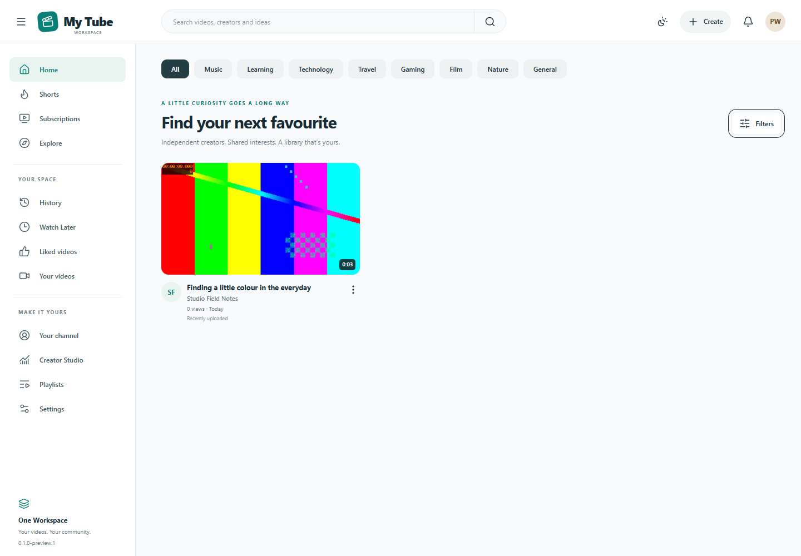

<div align="center">
  
  <h1>My Tube</h1>
  <p>Your videos, channels and community.</p>
  <p><a href="https://github.com/oneworkspacestudio/my-tube/releases"><strong>Download for Windows</strong></a> · <a href="https://github.com/oneworkspacestudio/one-workspace">One Workspace</a></p>
</div>

Your videos, channels and community, in a portable Windows application for
[One Workspace](https://github.com/oneworkspacestudio/one-workspace).

**Preview:** the working upload/playback, social, storage and identity workflows
are implemented and tested. Fresh Windows installation, service/reboot and live
Workspace deployment acceptance remain release gates; this is not a stable release.



## Run on Windows

Download the portable ZIP from [Releases](https://github.com/oneworkspacestudio/my-tube/releases),
verify SHA256SUMS, extract into a writable folder on NTFS, and open **MyTube.exe**.
The browser opens a one-use local setup link on the first launch. Complete the
setup wizard, register your MyAccounts client, then restart. No Docker, database
server, Node.js or Python is required at runtime. Windows may show a SmartScreen
prompt because the preview executable is unsigned.

For an explicitly single-user, loopback-only library, use **Start-local.cmd** or:

```powershell
.\MyTube.exe --local
```

This mode uses a one-use owner sign-in link. It cannot be exposed remotely or
installed as a Windows service. Normal multi-user operation uses MyAccounts.

## What works

- Multiple uploads, drag/drop, acknowledged chunk checkpoints, retry/resume,
  quotas, container verification, duplicate detection and atomic publication.
- Verified H.264/AAC MP4 playback with byte ranges without helpers. FFprobe
  enables broader container analysis. Optional FFmpeg creates posters and
  H.264/AAC HLS renditions with bounded workers, threads, memory and time limits.
- Desktop/mobile library, Shorts, filters, search, channel pages, Creator Studio,
  themes, player quality/speed/captions/fullscreen/cinema, chapters and autoplay.
- Channels, custom avatars/banners, metadata and thumbnails, private viewers,
  public/unlisted/private videos, replacement uploads and recoverable deletion.
- Likes, subscriptions, upload notifications, comments/replies/moderation,
  Watch Later, playlists, history/resume and explainable recommendations.
- User-scoped Quantum import/export, standalone media storage, administrative
  quotas/configuration/jobs/reports/audit, storage reconciliation and CLI backups.
- OIDC discovery, code + PKCE, signed token validation, server sessions,
  CSRF/Origin protection, and checks on metadata and every media derivative.

FFmpeg/FFprobe are **optional separate helper processes**, not part of the
one main executable. This release does not redistribute them. See
[media setup and licensing](docs/MEDIA.md). Unsupported codecs stay stored with
a clear processing message until the helpers are configured.

## Connect MyAccounts

Copy `config.example.json` to `config.json`, set `oidc_issuer`, `oidc_client_id`
and the exact browser-facing `public_url`. Register the callback
`PUBLIC_URL/auth/callback` with Authorization Code and PKCE S256. Discovery uses
the issuer's standard `/.well-known/openid-configuration`; endpoint URLs come
from its metadata. Profiles are keyed by `(issuer, sub)`, never by email.

```powershell
$env:MYTUBE_OIDC_CLIENT_SECRET='your-server-side-client-secret'
.\MyTube.exe --config .\config.json config-check
.\MyTube.exe --config .\config.json
```

Set `admin_subjects` to the exact MyAccounts subjects allowed to administer the
app. `MYTUBE_ADMIN_SUBJECTS` also accepts a comma-separated list. Administration
does not grant access to other users' private videos. The local logout revokes
the My Tube session; it does not log out other Workspace apps.

## One Workspace

The release includes `my-tube.workspace.json` with the **actual** executable
SHA256 and size. It uses `/my-tube`, port 8796, native OIDC, and the launcher's
injected confidential credentials. See [integration](docs/INTEGRATION.md) before
installing. No running Workspace installation is changed by building this repo.

## Data and recovery

`data/mytube.db` contains WAL SQLite metadata and FTS5 indexes. Dedicated media
folders contain `originals/`, `incoming/`, `streaming/`, `thumbnails/` and
`subtitles/`. Select a different disk with `media_dir` or `--media`.
Managed operation requires persistent Windows ACLs; exFAT is rejected for
managed runtime data. Do not point these paths at existing unrelated folders.

```powershell
# Stop the running server/service first. Store the backup on another disk.
.\MyTube.exe --file D:\Backups\tube.zip backup
# Restore to a NEW data directory; sessions are invalidated.
.\MyTube.exe --data C:\MyTubeRestored --file D:\Backups\tube.zip restore
.\MyTube.exe --data C:\MyTubeRestored
```

See [operations and recovery](docs/OPERATIONS.md), [configuration](docs/CONFIGURATION.md),
[API](docs/API.md), [architecture](docs/ARCHITECTURE.md), and
[security policy](SECURITY.md).

## Develop and test

Build tools: Go 1.27.2 and Node.js 26. Dependencies are pinned in go.mod/go.sum
and package-lock.json. The release application does not depend on these tools.

```powershell
npm --prefix web ci
npm --prefix web run build
go test -timeout 120s ./...
go vet ./...
go build -trimpath -ldflags '-s -w' -o dist/MyTube.exe ./cmd/my-tube
npm --prefix web test
cd web
node scripts/test-portable.mjs
```

UI trees live in `.aui` files and compile deterministically with
`@codedia/parser`. Edit adapters for browser controls; never edit generated TSX.
Always build web assets **before** compiling Go's embedded frontend.

Optional real integration checks:

```powershell
./scripts/test-myaccounts.ps1 -MyAccountsExe C:\Tools\MyAccounts.exe
$env:MYTUBE_TEST_FFMPEG='C:\Tools\ffmpeg.exe'
$env:MYTUBE_TEST_FFPROBE='C:\Tools\ffprobe.exe'
go test ./internal/app -run TestRealFFmpeg -v
cd web
$env:MYTUBE_TEST_DRIVE_EXE='C:\Tools\FileBrowser.exe'
$env:MYTUBE_TEST_HELPER_DIR='C:\Tools'
node scripts/test-drive.mjs
```

All integration fixtures create fresh isolated data and stop only their own
processes. The sample video is a self-generated FFmpeg test pattern; screenshots
show a disposable test library, not supplied user content.

## Release status

See [acceptance evidence](docs/ACCEPTANCE.md) for tested behavior and remaining
gates. Source is **AGPL-3.0-or-later**. Third-party notices ship with releases.
No Google or YouTube logos or proprietary media assets are included.
