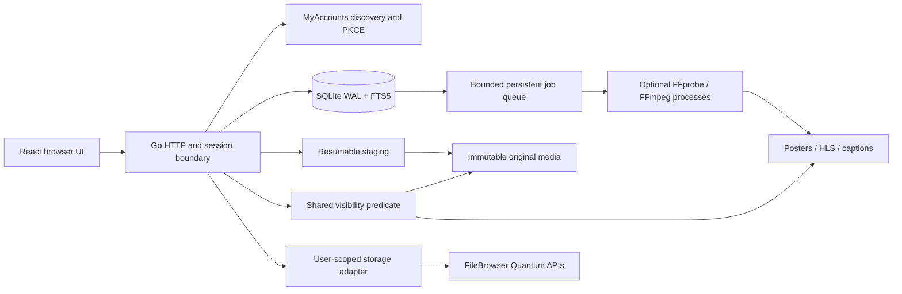

# Architecture

One Go executable embeds the production React frontend and schema migration.
No subprocess is necessary for conservative direct MP4 upload/playback. With
configured helpers, FFprobe validates streams and FFmpeg creates independent
renditions. Windows Job Objects limit each helper to one process and 1 GiB;
thread counts and contexts bound CPU parallelism and elapsed time. Generated
HLS sets are published by directory rename only after every rendition succeeds.
Failed jobs retain originals and can be retried. Direct playback remains usable
during a failed optional transcode.

The single SQLite connection serializes database access. Application writes
also use a mutex for quota and file/database consistency. The worker claims jobs
under that mutex but releases it during processing, so uploads and reads remain
available. Writes from other users wait during a synchronous Drive transfer.
Large public installations will need additional upload/import scheduling and
database throughput work; small self-hosted libraries are the initial target.

Chunk data is synced before the database offset is acknowledged. Recovery trims
unacknowledged tail bytes. Finalization renames within the media volume, then
inserts metadata/job/checkpoint in one transaction. An interrupted rename is
returned to staging on startup. Originals never appear as playable library
records until container validation and transaction completion succeed.

Quantum adapters use advertised/documented resource and authentication APIs;
there is no admin storage credential. An import is an explicit private snapshot
owned by the importing user. This copy is necessary for independent lifetime,
offline playback, backup and ownership of the imported item; the Drive source
is never edited or deleted. Direct shared-directory references are deliberately
not enabled: they would require an explicit per-user ACL mapping and ongoing
revocation checks. Derived media always stays in My Tube’s own storage.

`users` uses issuer/subject uniqueness. `channels` currently enforces one channel
per owner; videos reference channel IDs, leaving room for multi-channel ownership
in a future migration. All social relations are persisted. History supports
resume and retained authenticated viewer counts. Views and watch time are
lightweight client-reported aggregates, not forensic measurements.

Recommendations use recent uploads/popularity, subscriptions and watched
categories when personalization is enabled. Their reasons are returned with
each card. They use the same visibility predicate as direct metadata access.
FTS5 indexes video metadata including channel names/tags, plus playlist metadata.
Channel renames rebuild affected video search rows.
